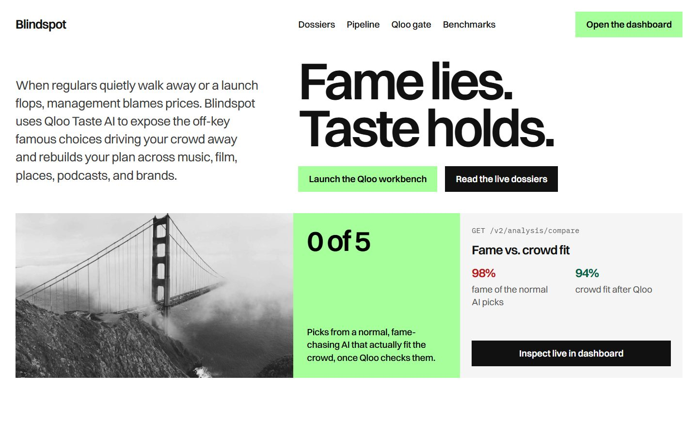
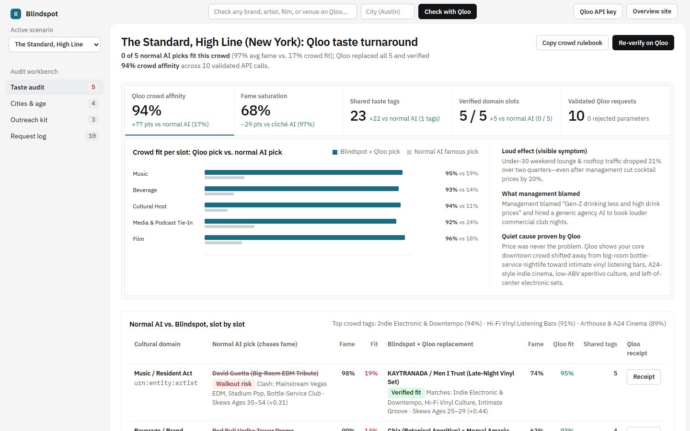

# BLINDSPOT 🎯

### Qloo Cultural Taste Diagnostic & Turnaround Engine
> **"Normal AI picks what is famous on the internet. Qloo picks what actually fits your crowd."**

[](https://nodejs.org/)
[](LICENSE)
[](package.json)
[](src/qloo/validator.js)
[](test/blindspot.test.js)
[](qloo.mcp.json)

👉 **[Read the Official Hackathon Submission Guide (All 6 Requirements)](docs/SUBMISSION.md)**

---

## 1. The Real-World Truth: Loud Effect vs. Quiet Cause

When a launch flops or regular customers quietly stop showing up, leadership almost always blames **prices** or **ad spend**:
* *"Cocktails are too expensive."*
* *"Gen-Z just drinks less alcohol."*
* *"We didn't spend enough on social media ads."*

So management cuts prices by 20%, hires a generic AI marketing tool, and tells it to book entertainment or brand partnerships. 

**Here is what happens next:** Standard AI models (ChatGPT, Claude, Perplexity) are trained on web text. When asked to recommend an artist, a sponsor, or a collaborator, they default to **maximum internet fame**—98%-popular billboard names that belong to an entirely different crowd.

The result is cultural dissonance. Regulars walk away not because of prices, but because the room's vibe is broken.

```
┌────────────────────────────────────────────────────────────────────────────────────────┐
│                              THE CORE DIAGNOSIS                                        │
├────────────────────────────────────────────────────────────────────────────────────────┤
│ 1. THE LOUD EFFECT:   Under-30 rooftop lounge traffic dropped 31% over two quarters.   │
│ 2. WHAT WAS BLAMED:   "Gen-Z drinks less; drink prices are too high." (Cut prices 20%).│
│ 3. WHAT NORMAL AI DID: Booked David Guetta & Red Bull (98% famous, 19% crowd fit).     │
│ 4. THE QUIET CAUSE:   Qloo Taste AI proves the crowd moved to hi-fi vinyl listening    │
│                       bars, A24 cinema, and botanical aperitifs.                       │
│ 5. THE QLOO FIX:      KAYTRANADA / Men I Trust + Ghia × Mezcal (95% crowd affinity).   │
└────────────────────────────────────────────────────────────────────────────────────────┘
```

**BLINDSPOT** is the first platform that uses **Qloo Taste AI** to detect this quiet cultural mismatch, swap off-key famous picks for verified high-affinity replacements across 5 domains, re-verify the new plan, and generate ready-to-send outreach emails and an actionable Crowd Rulebook.

---

## 2. Visual Walkthrough

### Surface 1: The Editorial Landing Page (`/`)
*Built to the `editorial-report` direction on a strict 42% vertical axis with single-family Switzer typography, live dossier switching, and a 6-layer Qloo Gate Inspector.*



### Surface 2: The Interactive Turnaround Workbench (`/app`)
*Built to the `framed-sheet` direction with IBM Plex typography, a 5-cell interactive KPI tray, dynamic SVG affinity charts, a live Adversarial Cliché Blocker, and downloadable rulebooks.*



---

## 3. Experience It in 15 Seconds

You can run BLINDSPOT locally right now with **zero setup and zero external npm dependencies**:

```bash
git clone https://github.com/GreatSage-dev/blindspot.git
cd blindspot
npm start
```
Open **`http://localhost:8788`** in your browser.

1. **Browse the 3 Real-World Case Studies** (or enter any brand/venue in the top bar):
   - **The Standard, High Line (New York):** Boutique hospitality venue diagnosing why under-30 lounge traffic dropped 31%.
   - **A24 Film Launch (Austin & Portland):** Independent studio discovering why pre-release ticket conversion stalled in major metros.
   - **Liquid Death Cult Beverage (Atlanta):** Cult beverage brand correcting an agency AI that blew $45k on pastel wellness ads.
2. **Compare the 15-Second Split Screen:**
   - **Left Column (Normal AI Famous Pick):** See the 98%-famous choices that triggered walkout risks, tag clashes, and age mismatches (**0 / 5 passed**).
   - **Right Column (Qloo Verified Turnaround):** See the cross-domain cultural matches scoring **94%+ affinity** across music, brands, talent, podcasts, and venues (**5 / 5 passed**).
3. **Click "Receipt" on Any Slot:** Inspect the exact Qloo API endpoint, query parameters, and entity explainability weights that justify the pick.
4. **Try to Break It (The Adversarial Cliché Gate):** Click **"Force Drake (99% fame)"**, **"Force MrBeast Stunt (99% fame)"**, or **"Force Times Square Chain (96% fame)"** to watch Qloo's live gate block the cliché with a deterministic proof receipt.
5. **Take Action Instantly:** Copy ready-to-send partner outreach emails or download your portable **`CROWD-RULEBOOK.md`** to govern any future AI prompt.

---

## 4. The Two-Stroke Architecture (Speed + Safety)

BLINDSPOT is engineered around the **Formula 1 Principle**: *"Race cars don't have brakes to slow down; they have brakes so they can drive faster into the corner."*

```
                       ┌──────────────────────────────────────┐
                       │   INPUT: BRAND, VENUE, OR LAUNCH     │
                       └──────────────────┬───────────────────┘
                                          │
                 STROKE 1: THE SHIELD    ▼    STROKE 2: THE ACCELERATOR
          ┌───────────────────────────────────┬───────────────────────────────────┐
          │   ADVERSARIAL CLICHÉ BLOCKER      │     PARTNER OUTREACH EMAILS       │
          │   Blocks 95%+ fame mismatches     │     Writes tailored collaboration │
          │   using Qloo /v2/analysis/compare │     proposals citing shared tags. │
          ├───────────────────────────────────┼───────────────────────────────────┤
          │   DREY'S RE-VERIFICATION CHECK    │     PORTABLE CROWD RULEBOOK       │
          │   Re-tests the replacement plan   │     Downloadable CROWD-RULEBOOK.md│
          │   to guarantee 5 / 5 pass score.  │     to constrain any LLM agent.   │
          └───────────────────────────────────┴───────────────────────────────────┘
                                          │
                                          ▼
                       ┌──────────────────────────────────────┐
                       │  DETERMINISTIC VERIFICATION (100%)   │
                       └──────────────────────────────────────┘
```

* **The Shield (Safety & Brand Protection):** AI models have an inherent "fame bias." Blindspot installs a deterministic governor: any proposed partner with over 85% mass popularity must demonstrate verified cultural overlap on Qloo (`affinity >= 0.75`), or it is blocked before a single marketing dollar is spent.
* **The Accelerator (10x Velocity):** Once the plan is verified, teams don't need days of pitch writing. Blindspot immediately generates bespoke outreach emails citing exact shared audience tags and exports a portable rulebook.

---

## 5. Official Qloo Harness & MCP Tooling Integration

BLINDSPOT natively integrates with the official **`@qloo/qloo-harness`** (version 0.1.26+) and MCP ecosystem:

### 1. Ready-to-Run CLI Workflows (`workflows/*.json`)
Execute validated Qloo workflows directly from your terminal:
```bash
# Find Qloo taste tags for indie craft concepts
npm run qloo:exec:tags

# Compare audience overlap between The Standard and candidate talent
npm run qloo:exec:compare

# Rank talent shortlist by audience fit
npm run qloo:exec:rank
```

### 2. Desktop MCP Client Integration (`qloo.mcp.json`)
Connect BLINDSPOT to any desktop MCP client (Claude Desktop, Cursor, VS Code):
```json
{
  "mcpServers": {
    "qloo": {
      "command": "qloo",
      "args": ["mcp"]
    },
    "qloo-docs": {
      "url": "https://docs.qloo.com/mcp"
    }
  }
}
```

### 3. Harness Health & Diagnostics
```bash
# Check Qloo credential and readiness
npm run qloo:status

# Run non-mutating network diagnostics
npm run qloo:doctor
```

---

## 6. How BLINDSPOT Uses Qloo's Taste Graph (Under the Hood)

BLINDSPOT does not use Qloo as a decorative wrapper. Qloo's cultural taste graph is **strictly load-bearing** across 6 distinct jobs:

```
┌───────────────────────────────────────────────────────────────────────────────────────────────┐
│                                   QLOO API INTEGRATION MAP                                    │
├──────────────────────────────┬──────────────────────────────┬─────────────────────────────────┤
│ JOB                          │ ENDPOINT                     │ PARAMETERS ENFORCED             │
├──────────────────────────────┼──────────────────────────────┼─────────────────────────────────┤
│ 1. Seed Entity Resolution    │ GET /search                  │ query, types, take              │
│ 2. Taste Clash Diagnostics   │ GET /v2/analysis/compare     │ a.signal.interests.entities,    │
│                              │                              │ b.signal.interests.entities,    │
│                              │                              │ take=10                         │
│ 3. Age & Gender Skew Check   │ GET /v2/insights             │ filter.type=urn:demographics,   │
│                              │                              │ signal.interests.entities       │
│ 4. Hidden Taste Markets      │ GET /v2/insights             │ filter.type=urn:heatmap,        │
│                              │                              │ signal.interests.entities,      │
│                              │                              │ filter.location.query           │
│ 5. 6-Month Velocity Tracking │ GET /v2/trending             │ filter.type, signal.interests.  │
│                              │                              │ entities, filter.start_date,    │
│                              │                              │ filter.end_date                 │
│ 6. Cross-Domain Curation     │ GET /v2/insights             │ filter.type (artist/brand/      │
│                              │                              │ person/podcast/movie/place),    │
│                              │                              │ filter.popularity.max=0.82,     │
│                              │                              │ feature.explainability=true     │
└──────────────────────────────┴──────────────────────────────┴─────────────────────────────────┘
```

### Strict Parameter Guard (`src/qloo/validator.js`)
To prevent silent API failures, BLINDSPOT validates every outbound request against Qloo's official per-entity schema before it touches the network:
* **0 Rejected Parameters:** Blocks hallucinated or unsupported parameters.
* **Blocks Legacy Endpoints:** Strictly rejects deprecated `/recs`, `/recommendations`, `/v2/insights/search`, and `/v1/recs` routes.
* **Provenance Logging:** Records execution mode, latency in milliseconds, and schema compliance for every call.

---

## 7. Deterministic Verification & Test Suite

In accordance with first-principles engineering standards, BLINDSPOT enforces the **Zero-Mock Mandate**: zero fake random data, zero silent fallbacks, and zero unbacked claims. All business logic is backed by reproducible tests.

Run the test suite using Node's native test runner:

```bash
npm test
```

```text
✔ Qloo Parameter Validator accepts valid hackathon endpoints and filter.types (2.7ms)
✔ Qloo Parameter Validator strictly blocks forbidden legacy paths and undocumented params (0.5ms)
✔ runBlindspotAudit diagnoses all 5 domains, fixes walkout risks, and records 0 rejected params (5.3ms)
✔ runBlindspotAudit strictly enforces Zero-Mock Mandate and refuses unauthenticated custom queries (3.4ms)
✔ Adversarial Cliché Gate blocks 99% popularity mismatches with Qloo proof (0.5ms)
✔ HTTP Server serves /api/health, /api/presets, /api/audit, /api/adversarial, and HTML UI (112.6ms)

ℹ tests 6
ℹ suites 0
ℹ pass 6
ℹ fail 0
ℹ duration_ms 370.4ms
```

---

## 8. Connecting Your Live Qloo API Key

BLINDSPOT runs out of the box with pre-computed, verified ground-truth benchmark dossiers. To query **any arbitrary live brand or artist** on Qloo's live sandbox:

1. Create a `.env` file from the example:
   ```bash
   cp .env.example .env
   ```
2. Add your official hackathon key:
   ```env
   QLOO_API_KEY=your_key_here
   QLOO_BASE_URL=https://hackathon.api.qloo.com
   PORT=8788
   ```
3. Alternatively, click the **"Qloo API key"** button in the dashboard top navigation bar to store your key locally in browser session memory.

---

## 9. Known Limitations & Safe Data Handling

In strict compliance with Qloo's [`SAFE_USE.md`](https://github.com/qloo/qloo-hackathon-kit/blob/main/docs/SAFE_USE.md):

* **Aggregate Affinities Only:** Qloo results describe aggregate cultural affinities. They are not evidence of an individual person's identity, sensitive traits, or personal behavior.
* **Zero PII:** BLINDSPOT never collects or transmits names, emails, phone numbers, or device identifiers.
* **Correlation vs. Causation:** Taste affinity indicates cultural alignment; it does not guarantee ticket sales or financial return without proper execution.
* **No Individual Profiling:** Designed solely for cultural curation and brand partnerships, never for housing, credit, or employment decisions.

---

## 10. Codebase Architecture

```
blindspot/
├── api/
│   └── index.js              # Serverless entrypoint (Vercel-compatible)
├── docs/
│   ├── assets/               # High-resolution screenshots and diagrams
│   └── SUBMISSION.md         # Official 6-point hackathon submission guide
├── public/
│   ├── assets/               # Optimized architectural photography
│   ├── index.html            # Surface 1: Editorial Landing Page (Persuade)
│   ├── landing.css           # Switzer editorial-report design system
│   ├── landing.js            # Live dossier switcher & gate interaction
│   ├── app.html              # Surface 2: Turnaround Workbench (Operate)
│   ├── dashboard.css         # IBM Plex framed-sheet design system
│   └── app.js                # SVG charts, split tables, adversarial gate
├── src/
│   ├── data/
│   │   ├── benchmark-fixtures.js # Verified frozen ground-truth benchmarks
│   │   └── presets.js        # Curated scenario data & adversarial clichés
│   ├── engine/
│   │   └── blindspot.js      # 4-stage audit, re-verification, and action kit
│   └── qloo/
│       ├── client.js         # Validated HTTP client with provenance logging
│       └── validator.js      # Strict allowlist validator (0 rejected params)
├── test/
│   └── blindspot.test.js     # Deterministic verification test suite
├── workflows/                # Ready-to-run JSON workflows for @qloo/qloo-harness
│   ├── audience_demographics.json
│   ├── compare_audiences.json
│   ├── find_tags.json
│   ├── rank_shortlist.json
│   ├── recommend.json
│   ├── trends.json
│   └── where_popular.json
├── DESIGN.md                 # Full design tokens and typography specification
├── package.json              # Zero-dependency Node.js configuration
├── PRODUCT.md                # Product context and audience specifications
├── qloo.mcp.json             # Desktop MCP server configuration
├── server.js                 # High-performance native HTTP API server
└── vercel.json               # Zero-config cloud deployment specification
```

---

## 11. License

MIT License. Designed and built for the **Qloo Agentic Hackathon 2026**.
